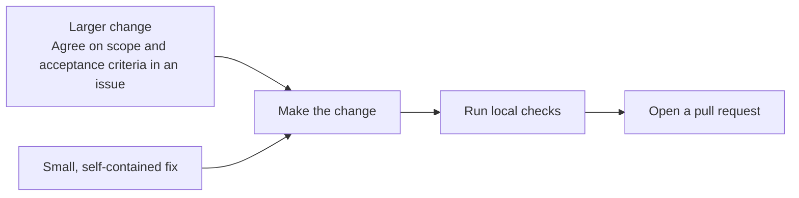

<!-- When updating this file, update CONTRIBUTING.zh.md in the same change. -->

# CONTRIBUTING

[简体中文](CONTRIBUTING.zh.md)

This document covers the project layout, local setup, testing, and development workflow. Run all commands below from the repository root.

## Project layout

```text
.
├── src/               # CLI source and colocated unit tests
├── tests/             # Reserved test suites and shared test resources
├── examples/          # Example drawings and expected output
├── scripts/git/       # Git hook setup
└── .github/           # Issue and PR templates and CI workflows
```

## Local development

### Requirements

- An up-to-date Node.js 22 release. [`.node-version`](.node-version)
- The pnpm version pinned under `packageManager`. [`package.json`](package.json)

### Setup

```sh
pnpm install --frozen-lockfile
```

For manual checks involving live imports, follow the setup in the [README](README.md#安装).

## Tests and checks

The project uses Vitest. Keep unit tests as `*.test.ts` files next to the code they cover. The directories under `tests/` are reserved for new suites and shared test resources.

```text
.
├── src/
│   └── converter/
│       └── index.test.ts  # Unit test example
└── tests/
    ├── e2e/               # End-to-end tests
    ├── fixtures/          # Shared test data
    ├── helpers/           # Shared test utilities
    └── integration/       # Tests across module boundaries
```

### Run tests and checks

```sh
pnpm test  # Run the tests
pnpm check # Type check, check formatting, and lint
```

Run a single test file.

```sh
pnpm test src/converter/index.test.ts
```

### Smoke test

Build the CLI and convert the basic example locally without Lark authentication.

```sh
pnpm build
node dist/index.js examples/feishu-poc.excalidraw
```

## CI

CI jobs and required checks are pending. Workflow definitions belong in [`.github/workflows/`](.github/workflows/).

## Development workflow



### Issues

On GitHub, open **Issues → New issue** and choose an entry below. Issue and PR titles and bodies can be in Chinese or English.

| What you want to do              | Where to start                                           |
| -------------------------------- | -------------------------------------------------------- |
| Report unexpected behavior       | Bug report                                               |
| Suggest a feature or improvement | Feature request                                          |
| Track maintenance work           | Blank issue, available to contributors with write access |

### Pull requests

- Use Conventional Commits for commit messages, for example `fix: preserve arrow labels`.
- Use the [PR template](.github/pull_request_template.md) to link the related issue if applicable, summarize the change, and record actual validation results.
