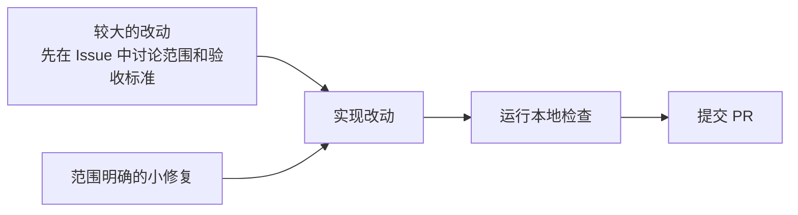

<!-- 更新本文件时，请在同一次改动中同步更新 CONTRIBUTING.md。 -->

# 贡献指南

[English](CONTRIBUTING.md)

本文介绍项目布局、本地环境、测试和开发工作流。以下所有命令均在项目根目录执行。

## 项目布局

```text
.
├── src/               # CLI 源码和同目录的单元测试
├── tests/             # 预留的测试套件和共享测试资源
├── examples/          # 样例画布和预期输出
├── scripts/git/       # Git hooks 配置
└── .github/           # Issue、PR 模板和 CI 工作流
```

## 本地开发

### 环境要求

- Node.js 22，使用该主版本的最新维护版本。[`.node-version`](.node-version)
- pnpm，使用 `packageManager` 固定的版本。[`package.json`](package.json)

### 配置步骤

```sh
pnpm install --frozen-lockfile
```

手动验证真实导入或截图时，按 [README](README.md#安装) 配置环境。

## 测试和检查

项目使用 Vitest。单元测试以 `*.test.ts` 命名，放在被测代码旁边。`tests/` 下的目录为新增测试套件和共享测试资源预留。

```text
.
├── src/
│   └── converter/
│       └── index.test.ts  # 单元测试示例
└── tests/
    ├── e2e/               # 端到端测试
    ├── fixtures/          # 共享测试数据
    ├── helpers/           # 共享测试工具
    └── integration/       # 跨模块的集成测试
```

### 运行测试和检查

```sh
pnpm test  # 运行测试
pnpm check # 检查类型、格式和 lint
```

运行单个测试文件。

```sh
pnpm test src/converter/index.test.ts
```

### 冒烟测试

构建 CLI 后运行基础样例，验证本地转换，无需登录飞书。

```sh
pnpm build
node dist/index.js examples/feishu-poc.excalidraw
```

## CI

CI 任务与必需检查待补充。工作流配置放在 [`.github/workflows/`](.github/workflows/) 中。

## 开发工作流



### Issue

在 GitHub 上通过 **Issues → New issue** 选择对应入口。Issue 和 PR 的标题、正文均可用中文或英文。

| 你想做什么       | 从哪里开始                         |
| ---------------- | ---------------------------------- |
| 反馈异常行为     | Bug report                         |
| 提出新功能或改进 | Feature request                    |
| 跟踪维护任务     | 空白 Issue，适用于有写权限的贡献者 |

### PR

- 提交信息遵循 Conventional Commits，例如 `fix: preserve arrow labels`。
- 用 [PR 模板](.github/pull_request_template.md) 关联相关 Issue（如有），简述改动，并记录实际验证结果。
